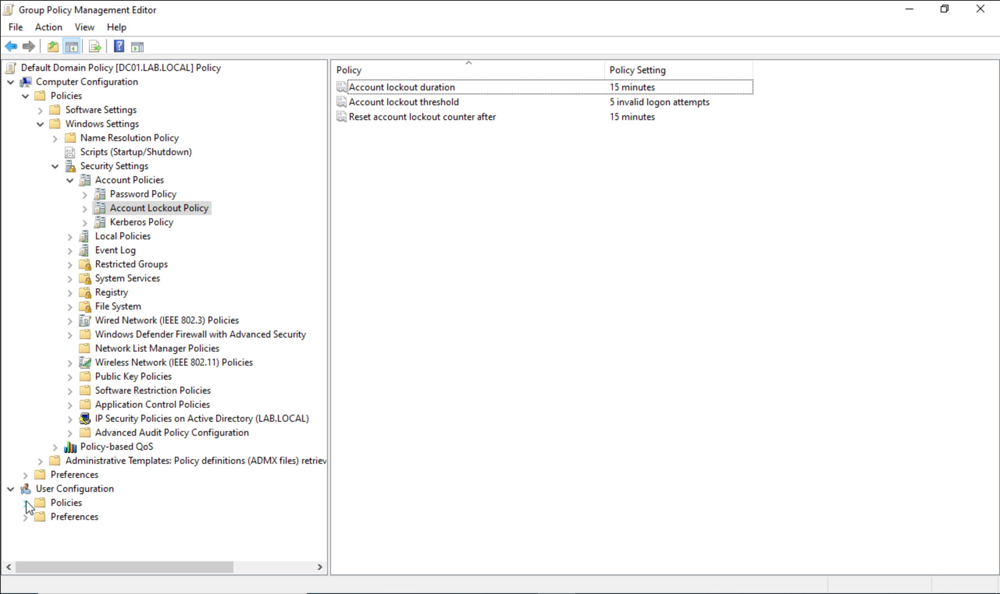
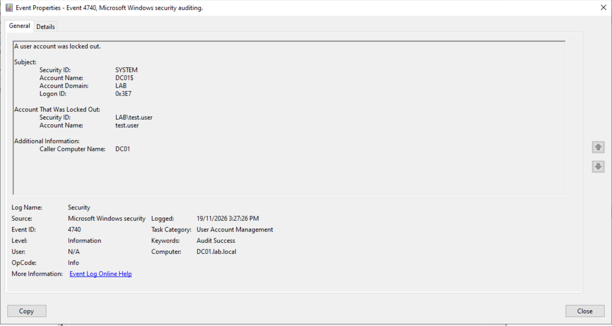

# Domain Controller: DC01


## Account lockout policy

### Goal
By default, Active Directory never locks an account (threshold 0), so someone can guess passwords against the domain forever. I set a lockout policy to stop brute-force and password-spraying attempts, and to make lockouts show up as a detectable event (4740) I can investigate.

### Settings
I changed these in the **Default Domain Policy** GPO (Computer Configuration -> Policies -> Windows Settings -> Security Settings -> Account Policies -> Account Lockout Policy):

| Setting | Before | After |
|---|---|---|
| Account lockout threshold | 0 (never locks) | 5 invalid logon attempts |
| Account lockout duration | 30 minutes | 15 minutes |
| Reset account lockout counter after | 30 minutes | 15 minutes |



### Steps taken
1. **Snapshot:** took a snapshot of VM 100 (DC01) called `pre-lockout-policy` on 19-11-2026 (no RAM) before changing anything.
2. **Test user:** created `test.user` (LAB\test.user) in the lab.local domain root with a throwaway password. 
3. **Recorded the before values** with `Get-ADDefaultDomainPasswordPolicy`.
4. **Edited the Default Domain Policy** with the three settings above.
5. **Applied the policy:** ran `gpupdate /force` on DC01.
6. **Triggered a lockout** by running a PowerShell script from DC01 that repeatedly tried a wrong password for `test.user`.

### Verification
```powershell
Get-ADUser test.user -Properties LockedOut, BadLogonCount, LockoutTime | Select Name, LockedOut, BadLogonCount, LockoutTime
```
```
Name        : Test User
LockedOut   : True
BadLogonCount : 5
LockoutTime : 134395360466183861
```
`LockoutTime` converts to 19-11-2026 3:27:26 PM, which matches the Event 4740 in the Security log.



The fields I look at in the event are **Account That Was Locked Out** (who) and **Caller Computer Name** (where the bad attempts came from). Here the caller is DC01, because I generated the attempts on the DC itself.

### Lab vs production
- I tested from DC01 using a script. In production, lockouts come from real client machines, and I'd trace them using the Caller Computer Name.
- `test.user` sits in the domain root. In production I'd use an OU.
- A threshold of 5 is a trade-off: low enough to slow guessing, high enough that an attacker can't easily lock everyone out by accident.

### Rollback
Set the lockout threshold back to 0 in the Default Domain Policy, run `gpupdate /force`, and delete `test.user`. Alternatively revert to the snapshot pre-lockout-policy.

### Environment notes
- Windows Server version: Microsoft Windows Server 2022 Standard Evaluation
- NetBIOS domain name: LAB