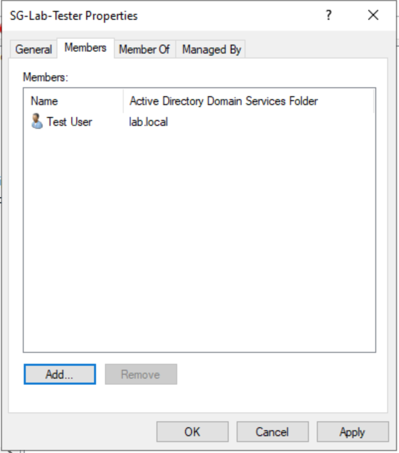

# Runbook: Add a user to a group

## When to use
A user needs access to something controlled by a security group (a file share, an app or a role), or I'm removing that access.

## Before I start
- Confirm the request is approved (a ticket or the user's manager) and exactly which group it's for. Least privilege applies.
- Never add anyone to a privileged group (Domain Admins, Enterprise Admins, Administrators) without explicit approval. These changes are exactly what an audit watches for.
- The user needs to log off and on again before the change takes effect, because group membership is built into the logon token. This is standard AD behaviour, but I haven't tested it because I don't have a Windows client VM yet.

## Steps
**GUI**
1. On DC01, open Server Manager → Tools → Active Directory Users and Computers.
2. Double-click the group → **Members** tab → **Add...**
3. Type the username, click **Check Names**, then OK. **Then click OK (or Apply) on the group's Properties dialog too**, because the change isn't applied until I do.



**PowerShell**
```powershell
Add-ADGroupMember -Identity <group> -Members <username>
```
To remove someone:
```powershell
Remove-ADGroupMember -Identity <group> -Members <username> -Confirm:$false
```
`-Confirm:$false` skips the "are you sure?" prompt. That's fine in the lab, but for important groups I'd leave the prompt on.

## Verify
```powershell
Get-ADGroupMember <group> | Select Name
Get-ADPrincipalGroupMembership <username> | Select Name, GroupCategory, GroupScope
```
```
Name           GroupCategory GroupScope
----           ------------- ----------
Domain Users   Security      Global
SG-Lab-Tester  Security      Global
```
The Security log records each change: Event **4728** when a member is added to a security-enabled global group, and **4729** when one is removed. I tested a GUI add, a PowerShell removal and a PowerShell add, and all three were logged. The 4728 event shows the member (`CN=Test User,DC=lab,DC=local`) and the group (`SG-Lab-Tester`). To list them:
```powershell
Get-WinEvent -FilterHashtable @{LogName='Security'; Id=4728,4729} | Select TimeCreated, Id | Format-Table
```

## Notes
- Only **Security** groups can grant access. A Distribution group is just for email lists.
- `SG-Lab-Tester` is a test group I created for practising this, and it sits in the domain root. In production I'd put groups in an OU and use a naming convention.
- Everyone is already in `Domain Users` by default.
- I did this as Administrator (a Domain Admin). In production, help desk staff would get delegated permission to manage specific groups only.