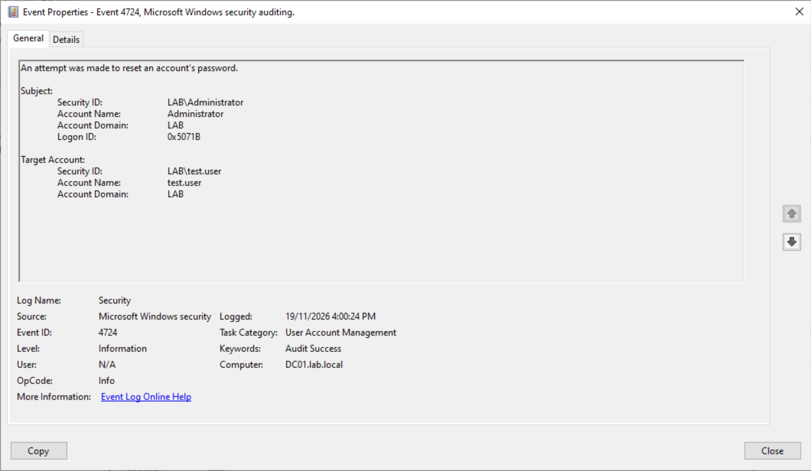

# Runbook: Reset a user's password

## When to use
A user has forgotten their password, or I suspect it's compromised.

## Before I start
- Verify the user's identity first (call back on a known number or check the ticket).
- Never send the temporary password by email or chat. Give it over a separate channel.
- Use a unique temporary password, never a predictable one.

## Steps
1. On DC01, open PowerShell as an administrator.
2. Reset the password. `Read-Host -AsSecureString` prompts me without showing the password or saving it in my command history:
   ```powershell
   Set-ADAccountPassword -Identity <username> -Reset -NewPassword (Read-Host -AsSecureString "New temporary password")
   ```
3. Force a change at next logon, so only the user knows the final password:
   ```powershell
   Set-ADUser -Identity <username> -ChangePasswordAtLogon $true
   ```

## Verify
```powershell
Get-ADUser <username> -Properties LockedOut, PasswordLastSet, PasswordExpired | Select Name, LockedOut, PasswordLastSet, PasswordExpired
```
```
Name      LockedOut PasswordLastSet PasswordExpired
----      --------- --------------- ---------------
Test User     False                            True
```
`PasswordLastSet` is blank and `PasswordExpired` is `True` because the user must change it at next logon. The reset is also logged as Event 4724:



## Notes
- Resetting a password doesn't unlock the account. In my lab, the account was still locked after the reset, so I unlock it separately (see [Unlock an account](unlock-account.md)).
- I couldn't test the forced change prompt, because I don't have a Windows client VM yet and standard users can't log on to the DC console.
- I did this as Administrator (a Domain Admin). In production, help desk staff would get delegated reset permissions only.