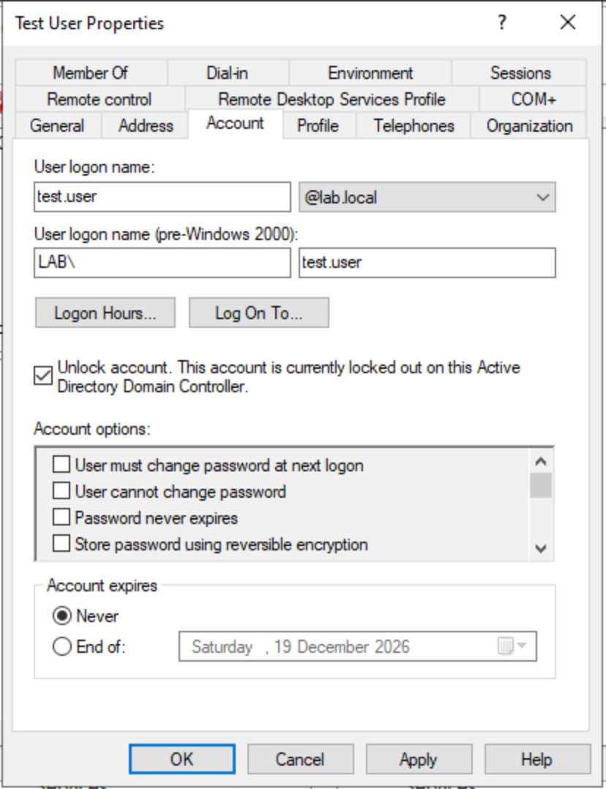
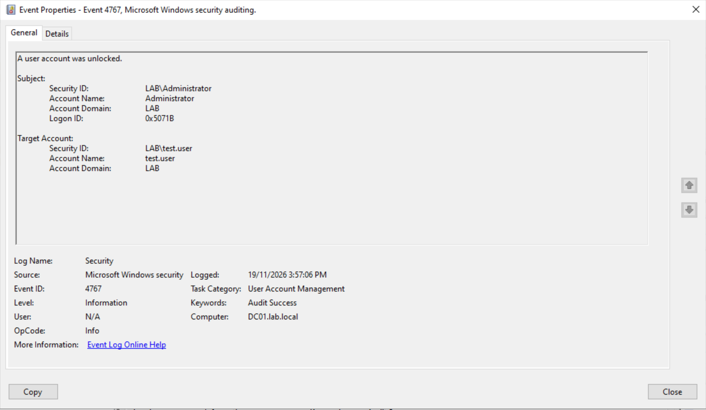

# Runbook: Unlock an account

## When to use
A user says they're locked out, or I see Event 4740 for them. The lockout policy (5 invalid attempts, 15 minute lockout) is in [02-ad-dc01.md](../02-ad-dc01.md). An account unlocks itself after 15 minutes, so a manual unlock just skips the wait.

## Before I start
- Verify the user's identity first. Attackers phone help desks pretending to be users.
- Find out why it locked. In Event 4740, **Caller Computer Name** shows where the bad attempts came from. A stale saved password on another device will just lock it again.

## Steps
1. On DC01, open Server Manager → Tools → Active Directory Users and Computers.
2. Find the user, right-click → Properties → **Account** tab.
3. Tick **Unlock account** and click OK.



PowerShell equivalent: `Unlock-ADAccount -Identity <username>`. I tested this in the lab and it took `test.user` from locked to unlocked.

## Verify
```powershell
Get-ADUser <username> -Properties LockedOut | Select Name, LockedOut
```
`LockedOut` should be `False`. The Security log also records who unlocked it (Event 4767):



## Notes
- Unlocking doesn't change the password.
- I did this as Administrator (a Domain Admin). In production, help desk staff would get delegated permission to unlock accounts only.